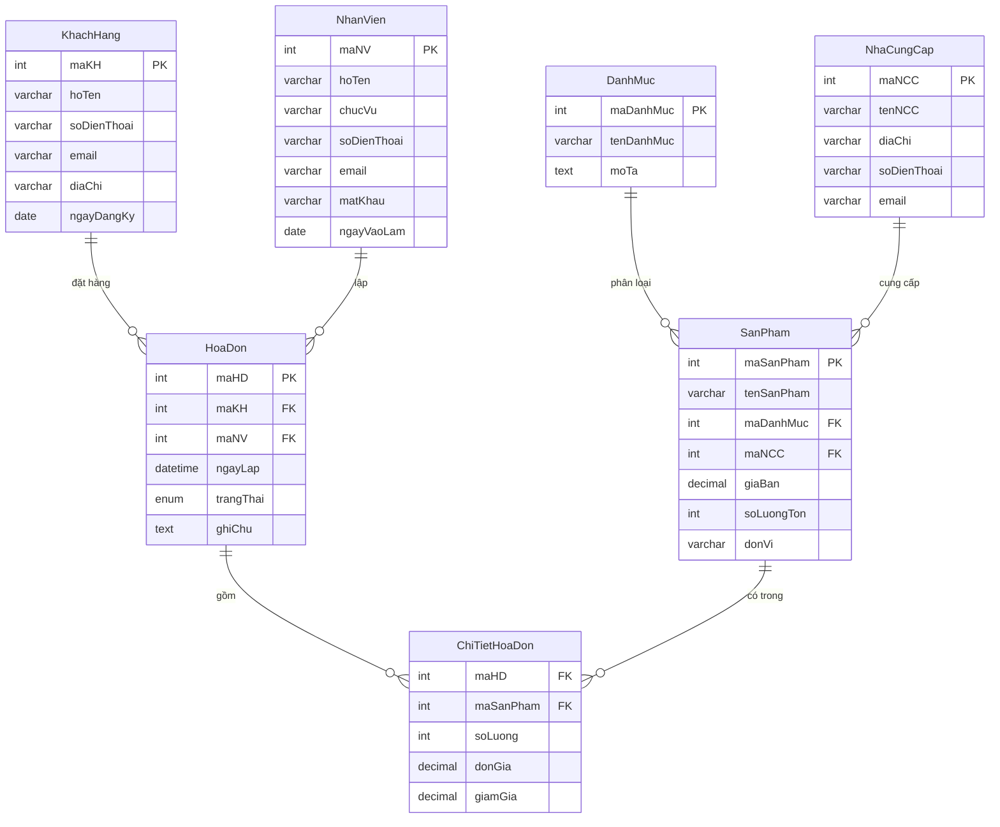

# ERD – Quản lý Bán hàng




## Các thực thể và thuộc tính

### DanhMuc
- **maDanhMuc** (PK)
- tenDanhMuc (UNIQUE, NOT NULL)
- moTa

### NhaCungCap
- **maNCC** (PK)
- tenNCC (NOT NULL)
- diaChi
- soDienThoai (UNIQUE, NOT NULL)
- email (UNIQUE)

### SanPham
- **maSanPham** (PK)
- tenSanPham (NOT NULL)
- *maDanhMuc* (FK → DanhMuc)
- *maNCC* (FK → NhaCungCap)
- giaBan (NOT NULL, > 0)
- soLuongTon (DEFAULT 0, ≥ 0)
- donVi

### KhachHang
- **maKH** (PK)
- hoTen (NOT NULL)
- soDienThoai (UNIQUE, NOT NULL)
- email (UNIQUE)
- diaChi
- ngayDangKy

### NhanVien
- **maNV** (PK)
- hoTen (NOT NULL)
- chucVu
- soDienThoai (UNIQUE, NOT NULL)
- email (UNIQUE)
- ngayVaoLam

### HoaDon
- **maHD** (PK)
- *maKH* (FK → KhachHang)
- *maNV* (FK → NhanVien)
- ngayLap
- trangThai (ENUM)
- ghiChu

### ChiTietHoaDon  ← bảng N-N
- **maHD** (PK, FK → HoaDon)
- **maSanPham** (PK, FK → SanPham)
- soLuong (NOT NULL, > 0)
- donGia (NOT NULL, > 0)
- giamGia (0–100)

---

## Quan hệ

| Từ | Quan hệ | Đến |
|---|---|---|
| DanhMuc | 1 – N | SanPham |
| NhaCungCap | 1 – N | SanPham |
| KhachHang | 1 – N | HoaDon |
| NhanVien | 1 – N | HoaDon |
| HoaDon | N – N (qua ChiTietHoaDon) | SanPham |

---

## Sơ đồ dạng text

```
DanhMuc ──< SanPham >── NhaCungCap
               │
               │ (qua ChiTietHoaDon)
               │
KhachHang ──< HoaDon >── NhanVien
```

---

## Lược đồ quan hệ

- DanhMuc(**maDanhMuc**, tenDanhMuc, moTa)
- NhaCungCap(**maNCC**, tenNCC, diaChi, soDienThoai, email)
- SanPham(**maSanPham**, tenSanPham, _maDanhMuc_, _maNCC_, giaBan, soLuongTon, donVi)
- KhachHang(**maKH**, hoTen, soDienThoai, email, diaChi, ngayDangKy)
- NhanVien(**maNV**, hoTen, chucVu, soDienThoai, email, ngayVaoLam)
- HoaDon(**maHD**, _maKH_, _maNV_, ngayLap, trangThai, ghiChu)
- ChiTietHoaDon(**_maHD_**, **_maSanPham_**, soLuong, donGia, giamGia)

---

## Chuẩn hóa 3NF

Tất cả bảng đều đạt 3NF:
- 1NF: Mỗi ô chứa giá trị nguyên tử, có khóa chính.
- 2NF: Các bảng có khóa ghép (ChiTietHoaDon) – mọi thuộc tính phụ thuộc đầy đủ vào khóa chính ghép.
- 3NF: Không có phụ thuộc bắc cầu (không có A→B→C nơi B không phải khóa).
